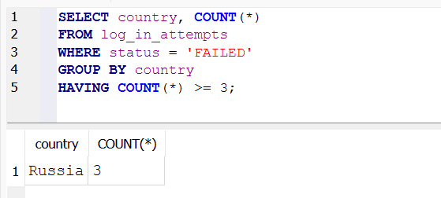
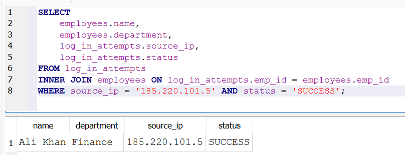
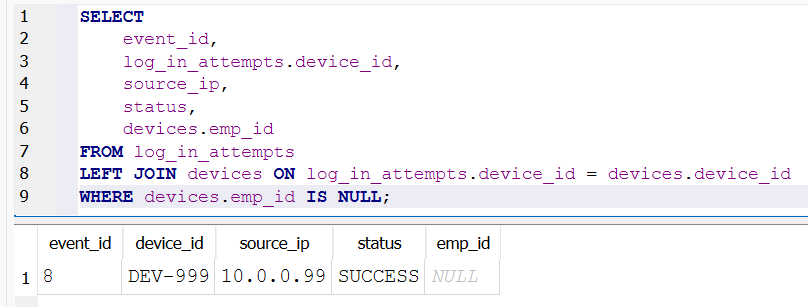
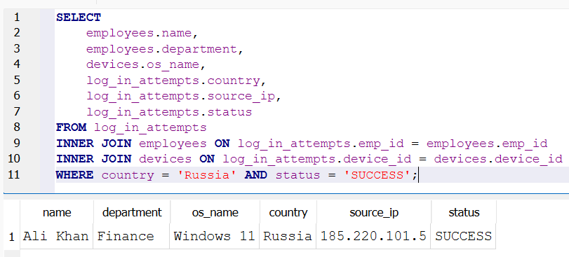

# SQL SOC Investigation Lab

A small security investigation project built with SQL and SQLite.

I made a fake company database, hid some suspicious activity inside it, and then used SQL to find it, the way a junior SOC (Security Operations Center) analyst would.

---

## Why I built this

I just finished the Google course **Tools of the Trade: Linux and SQL**. The labs were good, but they gave me the tables and the questions. I wanted to try the full job instead: design the database, create the data, and write the queries myself.

## The story

A small company has 5 employees, 5 laptops, and a log of login attempts.

On the night of 25 October 2026, someone from another country tries to log in to an employee's account. They fail three times, then get in on the fourth try. There is also a device nobody seems to own, and a laptop that has not been patched for almost a year.

My job is to find all of it.

> All names, devices, and IP addresses in this project are made up. No real data is used.

---

## Skills used

| Skill | Where I used it |
|---|---|
| `SELECT`, `FROM`, `WHERE` | Every query |
| `COUNT`, `GROUP BY`, `HAVING` | Queries 1 and 7 |
| `ORDER BY`, `LIMIT` | Query 7 |
| `INNER JOIN` | Queries 2, 3 and 6 |
| `LEFT JOIN` with `IS NULL` | Query 4 |
| Joining 3 tables | Query 6 |
| Comparison operators and `AND` | Queries 2, 3, 5 and 6 |
| `CREATE TABLE`, primary keys, `INSERT` | `schema.sql` |
| Linux command line (`sqlite3`) | Running the project |

---

## Database design

Three tables, linked by `emp_id` and `device_id`.

```
employees          devices                  log_in_attempts
---------          -------                  ---------------
emp_id (PK)  <---  emp_id                   event_id (PK)
name               device_id (PK)  <---     device_id
department         os_name                  emp_id
                   last_patch_date          login_time
                                            country
                                            source_ip
                                            status
```

- **employees**: who works at the company and in which department.
- **devices**: each laptop, who owns it, its operating system, and when it was last patched.
- **log_in_attempts**: every login with the time, country, IP address, and whether it worked.

---

## The 7 investigations

### 1. Find brute force attacks
Which countries have 3 or more failed logins?

```sql
SELECT country, COUNT(*) AS failed_attempts
FROM log_in_attempts
WHERE status = 'FAILED'
GROUP BY country
HAVING COUNT(*) >= 3;
```
**Result:** Russia, 3 failed attempts.



### 2. Connect the attacker to an employee account
Did the suspicious IP get into any account?

```sql
SELECT
    employees.name,
    employees.department,
    log_in_attempts.source_ip,
    log_in_attempts.status
FROM log_in_attempts
INNER JOIN employees ON log_in_attempts.emp_id = employees.emp_id
WHERE source_ip = '185.220.101.5' AND status = 'SUCCESS';
```
**Result:** Yes. Ali Khan (Finance) was logged in from that IP after the failed attempts. His account is likely compromised.



### 3. Find unpatched laptops
Which devices were last patched before August 2026?

```sql
SELECT
    devices.device_id,
    devices.os_name,
    devices.last_patch_date,
    employees.name,
    employees.department
FROM devices
INNER JOIN employees ON devices.emp_id = employees.emp_id
WHERE last_patch_date < '2026-08-01';
```
**Result:** `DEV-004`, a Windows 10 laptop owned by Maria Garcia (HR), last patched in November 2025.


### 4. Hunt for unknown devices
Which logins come from a device that is not registered to anyone?

```sql
SELECT
    event_id,
    log_in_attempts.device_id,
    source_ip,
    status,
    devices.emp_id
FROM log_in_attempts
LEFT JOIN devices ON log_in_attempts.device_id = devices.device_id
WHERE devices.emp_id IS NULL;
```
**Result:** `DEV-999` logged in successfully at 3 AM with no employee attached. This could be a rogue device.



### 5. Check logins from unusual locations
Which successful logins came from outside Pakistan?

```sql
SELECT
    emp_id,
    login_time,
    country,
    source_ip,
    status
FROM log_in_attempts
WHERE country != 'Pakistan' AND status = 'SUCCESS';
```
**Result:** 3 logins: Ali's login from Russia, the unknown device `DEV-999`, and Bilal's login from Brazil. Bilal logged in from Pakistan at 14:00 and from Brazil only 20 minutes later, which is a classic sign of impossible travel.

### 6. Build one full incident report
Combine all three tables to see the whole picture of the Russian login.

```sql
SELECT
    employees.name,
    employees.department,
    devices.os_name,
    log_in_attempts.country,
    log_in_attempts.source_ip,
    log_in_attempts.status
FROM log_in_attempts
INNER JOIN employees ON log_in_attempts.emp_id = employees.emp_id
INNER JOIN devices ON log_in_attempts.device_id = devices.device_id
WHERE country = 'Russia' AND status = 'SUCCESS';
```
**Result:** Ali Khan, Finance, Windows 11, logged in from Russia at IP `185.220.101.5`.


### 7. Find the top attacking IP

```sql
SELECT source_ip, COUNT(*) AS attack_count
FROM log_in_attempts
WHERE status = 'FAILED'
GROUP BY source_ip
ORDER BY COUNT(*) DESC
LIMIT 1;
```
**Result:** `185.220.101.5` with 3 failed attempts.

---

## What I would recommend

1. **Block the IP** `185.220.101.5` and reset Ali Khan's password right away.
2. **Turn on multi-factor authentication** for all accounts, starting with Finance.
3. **Lock accounts** after 3 failed attempts so brute force attacks stop early.
4. **Patch DEV-004** and set a rule that no device stays unpatched for more than a few months.
5. **Find the owner of DEV-999.** If nobody owns it, remove it from the network.
6. **Review Bilal's Brazil login** and confirm with him whether it was really him.

---

## How to run it

You need [SQLite](https://www.sqlite.org/download.html) installed.

Open a terminal in the project folder and start SQLite:

```bash
sqlite3 soc_lab.db
```

Then run these inside SQLite:

```
.read schema.sql
.headers on
.mode column
.read queries.sql
```

If you want to start fresh, delete `soc_lab.db` first and run the steps again.

---

## Project structure

```
sql-soc-investigation/
├── Assets/        screenshots of the results
├── schema.sql     creates the tables and adds the sample data
├── queries.sql    the 7 investigation queries
├── soc_lab.db     the SQLite database
└── README.md      this file
```

---

## What I learned

The course covered how operating systems work, how to use Linux and the Bash command line, and how to use SQL to ask databases questions. The main things I took from it:

- A security analyst spends a lot of time reading logs, and SQL makes that fast.
- Filtering with `WHERE`, `LIKE`, and `AND / OR / NOT` helps you narrow millions of rows down to the few that matter.
- Real questions usually need more than one table. Joins are how you connect them.
- `NULL` results in a `LEFT JOIN` are useful, because they show what is missing.

## What I want to improve

- Write a proper **impossible travel** query that checks the time gap between two logins from the same user.
- Add **foreign keys** to the schema so the tables are linked properly.
- Load a bigger dataset from CSV files.
- Automate the setup with a small Bash script.

---

## About me

**Ahmad Mujtaba**, 
CS Student @ UET Lahore | Aspiring Cybersecurity & AI Engineer

[](https://www.linkedin.com/in/ahmad-mujtaba-9b2539362)
[](https://github.com/ahmad-mujtaba648)
[](https://coursera.org/verify/F21TAS58K3SN)
